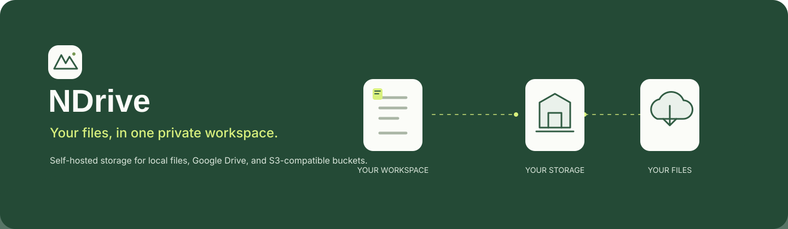
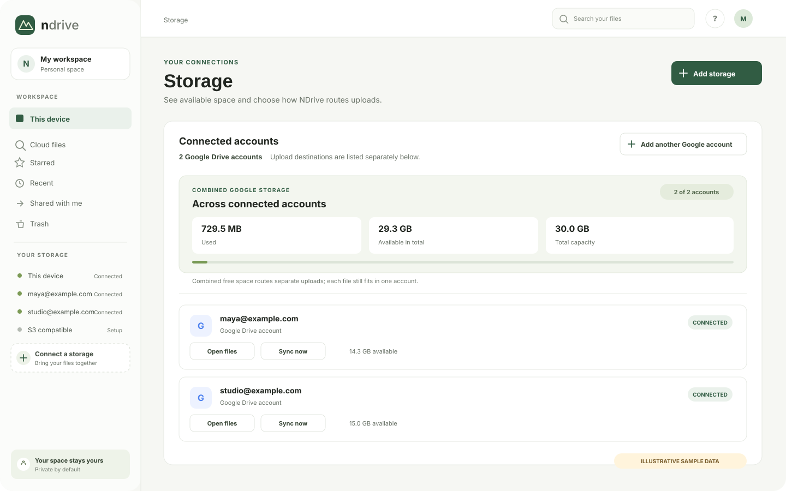

# NDrive

<div align="center">
  
  <br><br>
  
</div>

<p align="center"><strong>Your storage. Your server. One calmer place to work with files.</strong></p>

NDrive brings browser-local files, multiple Google Drive accounts, and an S3-compatible bucket into one self-hosted workspace. Browse and organize files, choose an upload destination, or let NDrive route each file to one connected destination.

<div align="center">
  
  <p><sub>Illustrative interface preview. Account names and quota values are fictional sample data.</sub></p>
</div>

## A quick tour

| Keep files close | Bring storage together | Route with clarity |
|:--|:--|:--|
| Keep files in this browser profile, or upload to a cloud provider. | Browse multiple Google Drive accounts and S3-compatible storage from one workspace. | See combined Google quota, while each uploaded file stays in one chosen account. |

<div align="center">
  
</div>

## Start here

| If you want to… | Open this guide |
|:--|:--|
| Run NDrive on your computer | [Quick start](docs/USER_GUIDE.md#requirements-and-first-launch) |
| Learn Docker and Compose step by step | [Docker guide](docs/USER_GUIDE.md#learn-docker-run-ndrive-with-compose) |
| Connect one or more Google Drive accounts | [Google Drive setup](docs/USER_GUIDE.md#connect-google-drive) |
| Configure AWS S3, Cloudflare R2, or another S3-compatible service | [S3 setup](docs/USER_GUIDE.md#connect-s3-compatible-storage) |
| Understand combined quota and upload routing | [Upload routing](docs/USER_GUIDE.md#upload-routing) |
| Back up the database and credentials | [Backups and recovery](docs/USER_GUIDE.md#backups-and-recovery) |
| Fix a setup or connection issue | [Troubleshooting](docs/USER_GUIDE.md#troubleshooting) |

## Quick start

Requires **Node.js 22.13 or newer**. From the project folder:

```bash
npm install
npm start
```

Then open [http://localhost:4173](http://localhost:4173) and create the owner account. For Docker, provider setup, and the full step-by-step instructions, follow the [NDrive User Guide](docs/USER_GUIDE.md).

## How it works

- NDrive runs on your computer or server; browser-local files stay in that browser profile.
- Google Drive and S3 credentials are handled by the NDrive server. Google refresh tokens are encrypted in SQLite.
- Multiple Google Drive accounts can contribute to a combined quota view. A single file upload still goes to one destination; NDrive does not split a file across accounts.
- Google sign-in for an NDrive user is separate from connecting Google Drive for file storage.

> **Private by default:** the server binds to `127.0.0.1` unless configured otherwise. Keep it on localhost or behind a private VPN. Do not expose it directly to the public internet.

> **Early-stage project:** NDrive has not completed an external security review or Google OAuth verification. It does not yet include email verification, password reset, or admin user management. Review [current limits](docs/USER_GUIDE.md#current-limits) before inviting users.

## Project details

- **Runtime:** Node.js 22.13+, built-in SQLite
- **Storage:** Browser IndexedDB, Google Drive, and one instance-configured S3-compatible bucket
- **Deployment:** Local Node.js or Docker Compose
- **Full documentation:** [NDrive User Guide](docs/USER_GUIDE.md)
